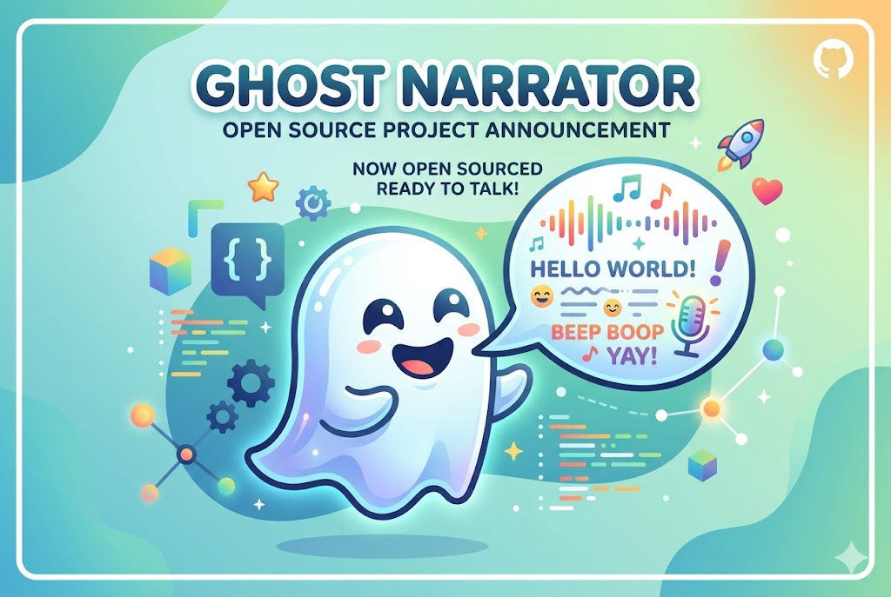
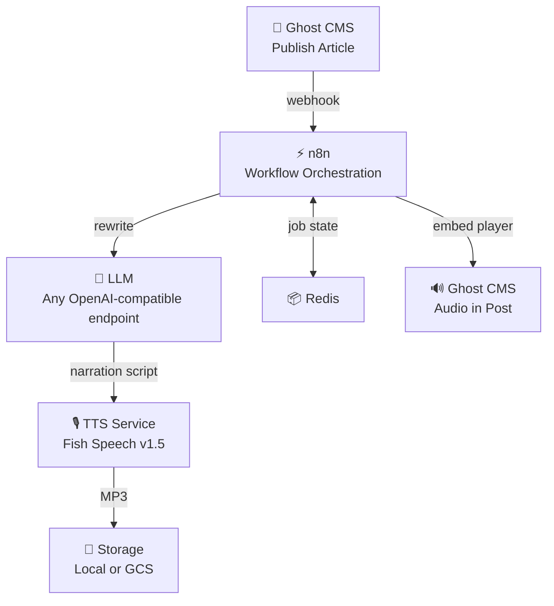

<p align="center">
  
</p>

# Ghost Narrator

Self-hosted AI narration for your blog. Replaces ElevenLabs (~$330/month) with a local stack that costs you electricity.

[](LICENSE)

> **Licensing Notice:** Ghost Narrator currently uses Fish Speech v1.5 for TTS, which is licensed under CC BY-NC-SA 4.0 (non-commercial use only). **This means you cannot use Ghost Narrator commercially as-is.** We are actively migrating to Qwen3-TTS (Apache 2.0) which will enable full commercial use. Stay tuned — ETA: this week. See [Licensing](#licensing) below for details.

---

## What It Does

Publish an article on Ghost CMS → Ghost Narrator automatically generates a voice-narrated audio version using your cloned voice and embeds the player in your post. No cloud TTS APIs. No per-character billing. Your voice, your hardware, your data.

```
Ghost CMS (publish) → n8n (orchestrate) → LLM (rewrite for narration) → Fish Speech v1.5 (synthesize) → Storage (MP3) → Ghost (embed player)
```

> **Hear it in action:** [your-ghost-site.com/blog](https://your-ghost-site.com/blog) *(replace with actual link)*

---

## Cost Comparison

| | ElevenLabs Scale | Ghost Narrator |
|---|---|---|
| Monthly cost | ~$330 | $0 (self-hosted) |
| Per-character billing | Yes | No |
| Voice cloning | Yes | Yes (30-60s voice sample) |
| Data privacy | Cloud | 100% local |
| Latency | Fast | ~2-5 min per article |
| Quality | Excellent | Good (some trade-offs) |
| Effort to set up | Sign up | ~1 hour |

---

## What You Need

Ghost Narrator lives in the `ghost-narrator/` directory. It needs three things:

1. **A Ghost CMS site** — self-hosted or Ghost Pro
2. **An LLM endpoint** — any OpenAI-compatible API (local or cloud)
3. **A GPU** — for voice synthesis with Fish Speech v1.5

That's it. You bring your own LLM, your own infrastructure. Ghost Narrator doesn't care if you're running Qwen on a Mac Mini, Llama on a rented GPU, or hitting the OpenAI API.

### Our Setup (Optional)

This repo also includes the AI infrastructure stack we run internally at SimpleDirect — vLLM (Qwen3-14B), ChromaDB, Open WebUI, and SearXNG. It runs on a single machine via the root `docker-compose.yml`. You're welcome to use it, but **Ghost Narrator works with any OpenAI-compatible LLM endpoint**. If you already have one, skip straight to the [Quick Start](#quick-start).

<details>
<summary>Want our full AI stack? Click here.</summary>

The root `docker-compose.yml` spins up:

| Service | Port | Description |
|---------|------|-------------|
| **vLLM (Qwen3-14B)** | 8001 | Local LLM inference, OpenAI-compatible API |
| **ChromaDB** | 8000 | Vector database for embeddings & RAG |
| **Open WebUI** | 3000 | Chat interface for your local models |
| **SearXNG** | 8888 | Private metasearch engine |

```bash
# Start the full stack
./start-core.sh

# Then point Ghost Narrator at it
VLLM_BASE_URL=http://host.docker.internal:8001/v1
VLLM_MODEL_NAME=Qwen/Qwen3-14B-AWQ
```

**Hardware for the full stack:** NVIDIA GPU with 16GB+ VRAM, 32GB RAM, 300GB SSD. We run everything on a single machine.

</details>

---

## Architecture



---

## Prerequisites

**Hardware:**
- NVIDIA GPU with 4GB+ VRAM for TTS only (16GB+ if also running your own LLM)
- 8GB+ RAM
- 50GB+ SSD

**Software:**
- Docker with Docker Compose V2
- NVIDIA Container Toolkit
- Git

**You also need:**
- A [Ghost CMS](https://ghost.org/) site
- An OpenAI-compatible LLM endpoint (local or cloud)
- A 30-60 second WAV recording of your voice (45+ seconds recommended)

---

## Quick Start

```bash
# Clone
git clone https://github.com/getsimpledirect/workos-mvp.git
cd workos-mvp/ghost-narrator

# Configure
cp .env.example .env
# Edit .env — at minimum set:
#   GHOST_SITE1_URL, GHOST_SITE1_ADMIN_API_KEY, GHOST_KEY_SITE1
#   VLLM_BASE_URL (any OpenAI-compatible endpoint)
#   SERVER_EXTERNAL_IP

# Add your voice sample (30-60 seconds WAV, 45+ recommended)
cp /path/to/your/voice.wav tts-service/voices/reference.wav

# Start
./scripts/init.sh
```

Then configure your Ghost site to send webhooks to:
```
http://YOUR_VM_IP:5678/webhook/ghost-published
```

Publish an article. Ghost Narrator handles the rest.

### Storage Options

**Local (default):** Audio files saved to `ghost-narrator/tts-service/output/`. No cloud account needed.

**Google Cloud Storage (optional):** For production, store audio in GCS:
```bash
./scripts/setup-gcp.sh
```

---

## Configuration

### Required

| Variable | Description |
|----------|-------------|
| `GHOST_SITE1_URL` | Your Ghost site URL |
| `GHOST_SITE1_ADMIN_API_KEY` | Ghost Admin API key (Settings → Integrations) |
| `GHOST_KEY_SITE1` | Ghost Content API key |
| `VLLM_BASE_URL` | Any OpenAI-compatible endpoint URL |
| `VLLM_MODEL_NAME` | Model name at that endpoint |
| `SERVER_EXTERNAL_IP` | VM's external IP for webhooks |
| `N8N_USER` / `N8N_PASSWORD` | n8n admin credentials |
| `N8N_ENCRYPTION_KEY` | Run `openssl rand -hex 32` |

### Optional

| Variable | Description | Default |
|----------|-------------|---------|
| `GCS_BUCKET_NAME` | GCS bucket for audio | *(local if unset)* |
| `TTS_DEVICE` | `cuda` or `cpu` | `cuda` |
| `MAX_WORKERS` | Parallel workers (CPU mode) | `4` |
| `MAX_CHUNK_WORDS` | Words per TTS chunk | `200` |
| `GHOST_SITE2_URL` | Second Ghost site | *(single site)* |

See [`ghost-narrator/.env.example`](ghost-narrator/.env.example) for the full list.

### LLM Compatibility

Ghost Narrator works with any OpenAI-compatible chat completion endpoint:

| Provider | `VLLM_BASE_URL` | `VLLM_MODEL_NAME` |
|----------|------------------|--------------------|
| Local vLLM (this repo) | `http://host.docker.internal:8001/v1` | `Qwen/Qwen3-14B-AWQ` |
| Ollama | `http://host.docker.internal:11434/v1` | `qwen3:14b` |
| OpenAI API | `https://api.openai.com/v1` | `gpt-4o-mini` |
| Any compatible | Your endpoint URL | Your model name |

### GPU Memory (if running the full stack)

| Service | VRAM |
|---------|------|
| vLLM (Qwen3-14B-AWQ) | ~8 GB |
| TTS (Fish Speech v1.5) | ~2-3 GB |
| **Total** | **~10-11 GB** |

---

## Multi-Site Support

Ghost Narrator supports multiple Ghost sites. The workflow automatically detects which site a post belongs to by matching the webhook URL hostname against your configured `GHOST_SITE1_URL` and `GHOST_SITE2_URL`.

See the [n8n Setup Guide](ghost-narrator/n8n/SETUP_GUIDE.md) for adding more sites.

---

## Troubleshooting

| Problem | Solution |
|---------|----------|
| TTS health check times out | First run downloads ~4GB models. Wait up to 5 min. |
| Webhooks don't trigger | Check `SERVER_EXTERNAL_IP` and firewall on port 5678. |
| Audio not embedded in Ghost | Verify Admin API key. Check: `docker compose logs n8n` |
| LLM errors | Test your endpoint: `curl $VLLM_BASE_URL/chat/completions` |
| vLLM crashes (full stack) | Check GPU: `nvidia-smi`. Reduce `--gpu-memory-utilization` (currently `0.75`). |

```bash
# Health checks
curl http://localhost:8020/health   # TTS Service
curl http://localhost:5678/healthz  # n8n
```

---

## Licensing

Ghost Narrator's code is MIT licensed — do whatever you want with it.

However, the **default TTS model matters**:

**Fish Speech v1.5 (current default)**
- Licensed under [CC BY-NC-SA 4.0](https://creativecommons.org/licenses/by-nc-sa/4.0/) and [Fish Audio Research License](https://github.com/fishaudio/fish-speech/blob/main/LICENSE)
- **Non-commercial use only** unless you obtain a separate commercial license from Fish Audio
- Fine for personal projects, research, non-commercial blogs

**Qwen3-TTS (coming soon as new default)**
- Licensed under [Apache 2.0](https://www.apache.org/licenses/LICENSE-2.0) — fully permissive, commercial use allowed
- Repo: [https://huggingface.co/Qwen/Qwen3-TTS](https://huggingface.co/Qwen/Qwen3-TTS)
- If you need commercial use now, you can swap to Qwen3-TTS yourself by updating the TTS service configuration to point to the Qwen3-TTS endpoint

**Target state:** MIT code + Apache 2.0 models = fully permissive end-to-end. No licensing asterisks.

The LLM component (Qwen 3.5 14B via Ollama) is already Apache 2.0 — no issues there.

You are responsible for complying with the licenses of the underlying models you choose to use.

---

## Documentation

- [Architecture Guide](ghost-narrator/docs/ARCHITECTURE.md) — full pipeline walkthrough
- [TTS Service Docs](ghost-narrator/tts-service/README.md) — API reference & standalone usage
- [TTS Quick Start](ghost-narrator/tts-service/QUICKSTART.md) — get TTS running in 5 minutes
- [n8n Setup Guide](ghost-narrator/n8n/SETUP_GUIDE.md) — workflow configuration
- [Contributing](ghost-narrator/CONTRIBUTING.md)
- [Security Policy](ghost-narrator/SECURITY.md)

---

## License

MIT License (code). See [Licensing](#licensing) for model license details.

---

## Support

- [GitHub Issues](https://github.com/getsimpledirect/workos-mvp/issues)
- [GitHub Discussions](https://github.com/getsimpledirect/workos-mvp/discussions)

---

Built by [SimpleDirect](https://getsimpledirect.com)
